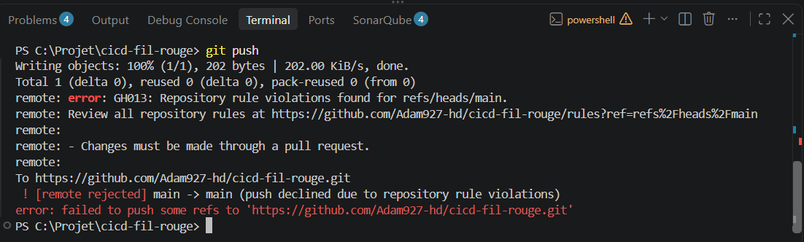
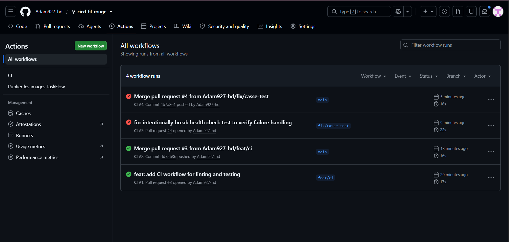
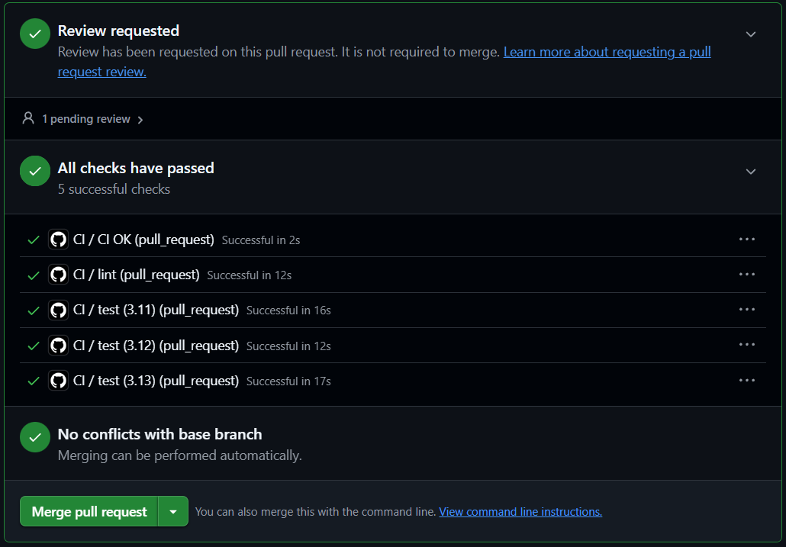

# TaskFlow — dépôt fil rouge CI/CD

TaskFlow est une petite API de gestion de tâches écrite en Python avec FastAPI.
C'est le projet fil rouge du module CI/CD (Mastère DevOps M1, Sup de Vinci) :
pendant trois jours, vous allez construire autour d'elle un pipeline complet
qui teste, construit, sécurise et livre l'application.

## Lancer l'API en local

Prérequis : Python 3.10 ou plus récent.

```bash
python3 -m venv .venv
source .venv/bin/activate          # Windows : .venv\Scripts\activate
pip install -r requirements-dev.txt
uvicorn app.main:app --reload
```

L'API répond sur http://localhost:8000 et sa documentation interactive est sur
http://localhost:8000/docs.

## Vérifier le code

```bash
pytest           # tests automatiques
ruff check .     # lint
ruff format .    # mise en forme
```

## Lancer avec Docker

```bash
docker build -t taskflow .
docker run --rm -p 8000:8000 taskflow
```

## Endpoints

| Méthode | Chemin                | Rôle                                              |
| ------- | --------------------- | ------------------------------------------------- |
| GET     | `/health`             | État de l'API et version                          |
| GET     | `/tasks`              | Liste des tâches                                  |
| GET     | `/tasks/search?q=...` | Recherche dans les titres                         |
| POST    | `/tasks`              | Crée une tâche (`{"title": "..."}`)               |
| GET     | `/tasks/{id}`         | Détail d'une tâche                                |
| PATCH   | `/tasks/{id}/done`    | Marque une tâche comme faite                      |
| DELETE  | `/tasks/{id}`         | Supprime une tâche (en-tête `X-API-Token` requis) |

## Configuration

| Variable             | Rôle                                      | Défaut                        |
| -------------------- | ----------------------------------------- | ----------------------------- |
| `APP_VERSION`        | Version affichée par `/health`            | `0.1.0`                       |
| `DB_PATH`            | Fichier SQLite                            | `taskflow.db`                 |
| `API_TOKEN`          | Jeton exigé pour supprimer une tâche      | vide (suppression désactivée) |
| `NOTIFY_WEBHOOK_URL` | Webhook appelé à chaque création de tâche | vide (désactivé)              |

## Équipe

<!-- Lab J1 : remplacez par les noms du binôme -->

- Adam Halbelaid
- Moustapha ARAFAT

## Gouvernance du dépôt

<!-- Lab J1 : listez les règles activées sur main, pourquoi chacune, et ajoutez la capture du push refusé -->

À compléter.

## Protection de la branche main

Push direct sur `main` refusé par le ruleset :



## CI : merge bloqué si les tests échouent

Le workflow `.github/workflows/ci.yml` lance deux jobs **en parallèle** à chaque Pull Request
vers `main` :

- **`lint`** : `ruff check .` vérifie le style et détecte les erreurs courantes (imports
  inutilisés, variables non définies…)
- **`test`** : `pytest` exécute la suite de tests de l'API

Ces deux checks sont déclarés **obligatoires** dans le ruleset de `main`
(_Require status checks to pass_). Tant qu'ils ne sont pas verts, le bouton de merge reste
bloqué.

**Démonstration :** sur la branche `fix/casse-test`, le test `test_health_returns_ok` a été
volontairement cassé (on attend `"ko"` au lieu de `"ok"`). Résultat :

- ✅ `lint` passe : le code est syntaxiquement correct
- ❌ `test` échoue : `AssertionError`
- 🚫 **Merging is blocked**, même avec l'approbation du binôme



**Pourquoi c'est important :** la relecture humaine ne suffit pas, car un relecteur peut
approuver du code qui casse une fonctionnalité sans s'en rendre compte. Les checks
obligatoires garantissent automatiquement que **`main` reste toujours fonctionnel et
livrable** : aucun code ne peut y entrer sans avoir passé le lint et les tests. La PR a
ensuite été fermée sans être mergée.

## Pipeline CI : PR verte mais bloquée

Sur la branche `feat/ci-rapide`, le workflow a été accéléré et enrichi : cache pip, matrice
Python **3.11 / 3.12 / 3.13**, rapport de tests publié en artefact et `concurrency` pour annuler
les runs obsolètes.

En ouvrant la PR, **tous les jobs sont verts**, et pourtant le merge reste **bloqué**.

**Pourquoi ?** Avec la matrice, le job `test` n'existe plus sous ce nom : GitHub crée trois jobs
nommés `test (3.11)`, `test (3.12)` et `test (3.13)`. Or le ruleset de `main` exige toujours un
check nommé exactement **`test`**. Ce check n'est plus jamais publié, donc GitHub l'affiche en
_Expected — Waiting for status to be reported_ et attend indéfiniment.



**Leçon :** déclarer chaque job comme check obligatoire est fragile, car renommer un job ou
ajouter une version à la matrice suffit à bloquer toutes les PR. D'où la correction suivante :
un job unique `CI OK` qui agrège les résultats et devient le seul check obligatoire.
